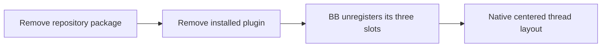

# Activity Overview removal design

## User result

Activity Overview no longer appears on New Thread, in Settings, or in thread
actions. BB core remains the sole owner of the centered thread layout.

## Ownership

The plugin owns no server behavior, persisted data, settings, secrets, or
schedules. Its complete runtime behavior comes from three app registrations:
`homepageSection`, `settingsSection`, and `threadPanelAction`.

After removal:

- BB core owns thread layout and centering.
- `.bb/plugins.json` lists the remaining installable plugins.
- `README.md` documents the remaining plugin catalog.
- `package-lock.json` records the remaining workspace dependency graph.
- The BB runtime registry contains no `activity-overview` installation.

## Repository changes

1. Delete `plugins/activity-overview/`.
2. Remove its object from `.bb/plugins.json`.
3. Remove its standalone catalog paragraph from `README.md`.
4. Run `npm install` to remove its workspace records from `package-lock.json`.
5. Leave BB core and all other plugin source unchanged.

This design adds no types, functions, configuration, compatibility layer, or
layout CSS. Absence is the required state.

## Runtime verification

Remove the installed plugin with `bb plugin remove activity-overview`. Verify
that `bb plugin list --json` no longer returns the id, then inspect an active
thread and New Thread in BB Browser. The dashboard must be absent and the
native thread column must be centered.

## Risks

- Repository deletion does not uninstall copies on other hosts.
- A stale installed record or browser bundle can make the retired UI appear
  present until BB removes the installation and reloads the page.
- Lockfile regeneration can produce unrelated churn, so the diff must contain
  only records tied to the removed workspace.
- The checkout contains unrelated Empirical changes. The commit must include
  only this feature's records and product changes.

## Alternatives

- Removing only `homepageSection` would leave Activity Overview in Settings
  and thread actions.
- Removing all registrations but retaining the package would leave an
  installable plugin with no capability.
- Adding centering CSS would create a second owner for BB core layout.
- Changing BB core is outside this repository and is unnecessary when the
  plugin registration is absent.
