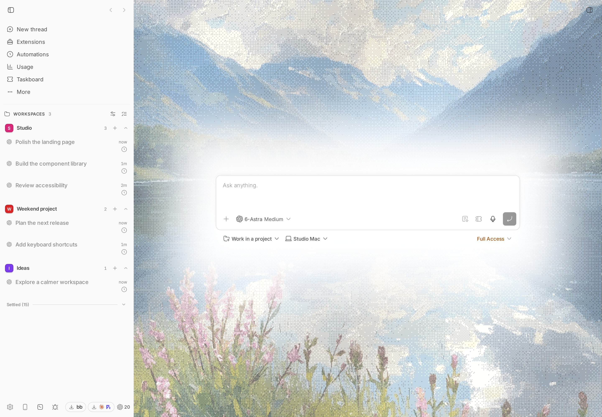
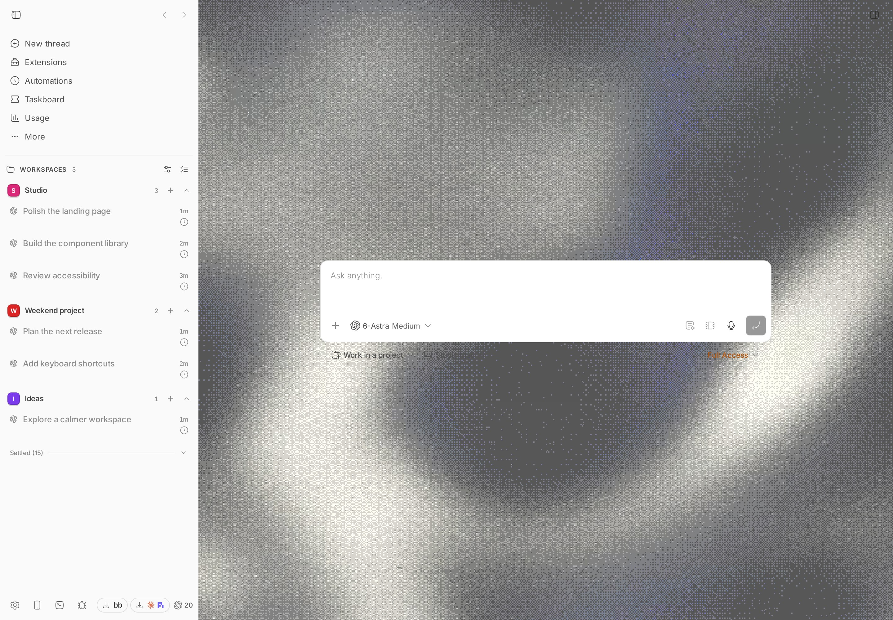

# Aura

Personal PNG/JPG and animated GIF backgrounds, Capy's animated dithering effect, six saved
slots, and an optional GitHub activity overview for BB. Open **Settings → Aura**,
or **+ → Actions → Aura** in a thread panel.

## Activity overview

Turn on **Activity overview** in **Settings → Aura** to show a compact overview
below the native New thread composer. It is off by default and saves immediately,
without applying or discarding your background draft. This preference stays
global when switching slots or resetting a background. Composer centering stays
active with the overview or wallpaper disabled; short windows and long drafts
remain scrollable. The overview is part of AURA, with no extra plugin required.

The BB server needs an authenticated [GitHub CLI](https://cli.github.com/): run
`gh auth login` directly on that server if necessary. AURA invokes `gh api` against
GitHub; credentials stay in the CLI and are never sent to the browser. The
overview makes no activity requests while disabled. Results are cached for five
minutes, with an update time displayed in the UI.

- **Contributions:** actual dated GitHub contribution-calendar counts. The
  selected period covers 30, 90 or 365 inclusive UTC dates ending today. Dates
  retain GitHub's contribution-day attribution; today's counts are still changing.
- **PRs opened / merged:** authored PR counts by creation or merge date. These
  use different events and can differ from contribution totals.
- **Review contributions:** GitHub's counted pull-request review contributions,
  rather than every individual review comment.
- **Patterns:** longest consecutive active streak within the selected period;
  current streak ends today or, if today has zero contributions, yesterday.
  Busiest date/month come from dated counts; earliest dates win ties. Streaks
  are bounded by the selected interval.
- **Repositories:** actual contribution repositories returned by GitHub, up to
  100 per contribution category. Scoped PR counts and available review counts
  requery that repository. GitHub's global contribution calendar has no repository
  filter, so repository contributions, calendar and patterns display **Unavailable**.
  AURA never reuses global counts under a repository label.
- **Links:** open your real authored PRs and review-request search on GitHub.
  No invented attention items or example activity ship in the overview.

Visibility follows the authenticated account's GitHub permissions and private
contribution settings. Loading, incomplete, missing-authentication and API-error
states omit unconfirmed metrics and offer retry where appropriate. A complete
empty response shows zero activity explicitly. Source failures never become zero.
The heatmap scrolls inside its own keyboard-accessible region on narrow screens.

## Use Aura

In **Settings → Aura**, use **Half wallpaper on New thread**:

- **On:** the wallpaper appears in the upper half and fades out at the midpoint.
- **Off:** New thread shows the full wallpaper.
- Chats always show the full wallpaper in their margins, with readable message
  and table backgrounds. There is no dimmer button in the composer.

Select **Apply background** to save the setting.

- Choose or drop a PNG/JPG (up to 32 MB). Large images are resized automatically
  to fit the 2 MB stored-image limit. The preview shows the result before saving.
- Or choose an animated GIF (up to 8 MB and 4,096 px per side). GIFs are stored as uploaded — resizing
  would drop their animation — and play frame by frame through Capy dithering.
  With **No texture**, the browser plays the GIF directly.
- Adjust image visibility (0–100%), half-wallpaper mode, fit, and Capy dithering.
  The half-wallpaper setting affects New thread only. Photo dithering now animates with a gentle threshold wave.
- Without an image, choose a **Pattern**: Drifting noise (the default), Warp,
  Falling dots, Sine wave, Ripple, Swirl or Lit sphere. With an image, choose its
  **Texture motion**: Wave (the default), Ripple, Diagonal drift, Shimmer or Still.
- Choose a **Dither**: Grain, or a 2×2, 4×4 or 8×8 (the default) ordered grid.
- Choose **Animation speed** (15/30/60 FPS) and **Render quality**
  (Performance/Balanced/Sharp). Higher settings use more GPU; saved slots retain them.
- Select **Apply background** to apply the current draft.
- Choose a slot, enter a name, and select **Save slot** to save and apply the draft.
  Occupied slots have an explicit **Replace slot** button. Each slot keeps its
  image and appearance independently; click its card to switch immediately.
- **New thread screen only** hides Aura inside existing conversations. Apply it
  to save. This scope and the Enabled preference remain global when switching slots.
- **Clear** removes a saved slot without removing the currently displayed image.
  **Reset to default** restores the noise effect while keeping your saved slots
  and global scope/enabled preferences.

Settings and slots are shared across this BB server and its remote clients.
The current window updates immediately; other windows refresh on focus or within
15 seconds. Images stay in plugin-owned SQLite and are served through a
BB-authenticated image route. Images are not sent to Capy or included in prompts.

## Install

Requires BB 0.40+ and SDK 0.4.21+. From the workspace root:

```sh
npm install
npm run check --workspace bb-plugin-aura
bb plugin install ./plugins/aura --yes
bb plugin reload aura
```

The published background release can also be installed with:

```sh
bb plugin install git:https://github.com/MateoCerquetella/bb-plugins.git@^0.2.3 \
  --subdirectory plugins/aura --tag-prefix aura/
```

The activity overview is currently implemented in this checkout; it has not
been published in the Git release above. Installing from the workspace uses it.




## CLI

```sh
bb aura status --json
bb aura slots
bb aura use 1
bb aura new-thread-only on
bb aura new-thread-only off
bb aura overview on
bb aura overview off
bb aura enable
bb aura disable
bb aura reset
```

Use the settings UI to upload and save slots. CLI output contains metadata,
never image bytes.

## Reading and composing

Existing conversations have an opaque, theme-colored reading column. Background
images remain undimmed in the side margins all the way to the bottom, including
beside the composer, never directly behind message text.
Wide Markdown tables get an opaque backing across their entire width, including
where they extend beyond the normal reading column.
Half-wallpaper mode applies only to the New thread screen.
The New thread composer stays centered, with the optional overview below it.
Short windows and long drafts remain scrollable. Background styling follows
Aura's enable/scope settings; composer centering stays independent of them.

## Effect and verification

The shader and fade masks come from [Capy](https://capy.ai/new). Source URLs and
the Paper Shaders Apache-2.0 license are recorded in
[THIRD_PARTY_NOTICES.md](./THIRD_PARTY_NOTICES.md). Wallpaper requests stay local;
the optional overview requests GitHub activity from the BB server.

Aura decorates BB's `root-compose-main-panel` and `thread-detail-timeline-panel`
DOM containers. Recheck these host names when upgrading BB. Canvas/GL resources,
observers and listeners are disposed when disabling or reloading. Noise and photo animation
run at the chosen FPS and pause off-screen, when hidden, and for reduced motion.
GIF frames keep their own timing and are decoded with WebCodecs' `ImageDecoder`;
without it, the shader shows the first frame. The image/gradient remains if WebGL is unavailable.

```sh
npm run check --workspace bb-plugin-aura
```

Unit tests cover atomic apply/rejection, six-slot persistence and replacement,
global scope/overview preferences across switches, deletion/reset, legacy settings, and DOM cleanup
when switching to New thread only. The opt-in live browser test additionally
checks real uploads, slot switching, and the scope toggle while preserving the
user's active image and saved slots.
Activity tests cover UTC date ranges, gaps/ties/streaks, actual response parsing,
auth/source failures, scoped queries, discovery bounds, cache expiry/coalescing,
late responses, retry and disabled/empty/unavailable states. The component tests
use the SDK's isolated slot harness; installed-host screenshots require a
signed-in BB browser session.
