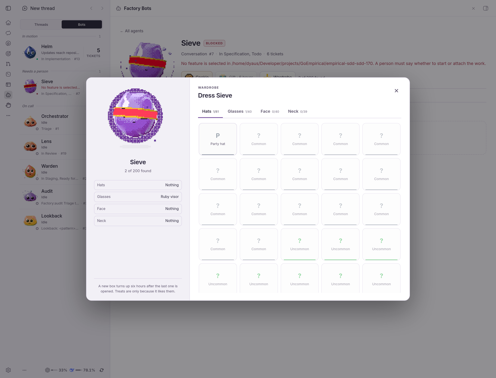
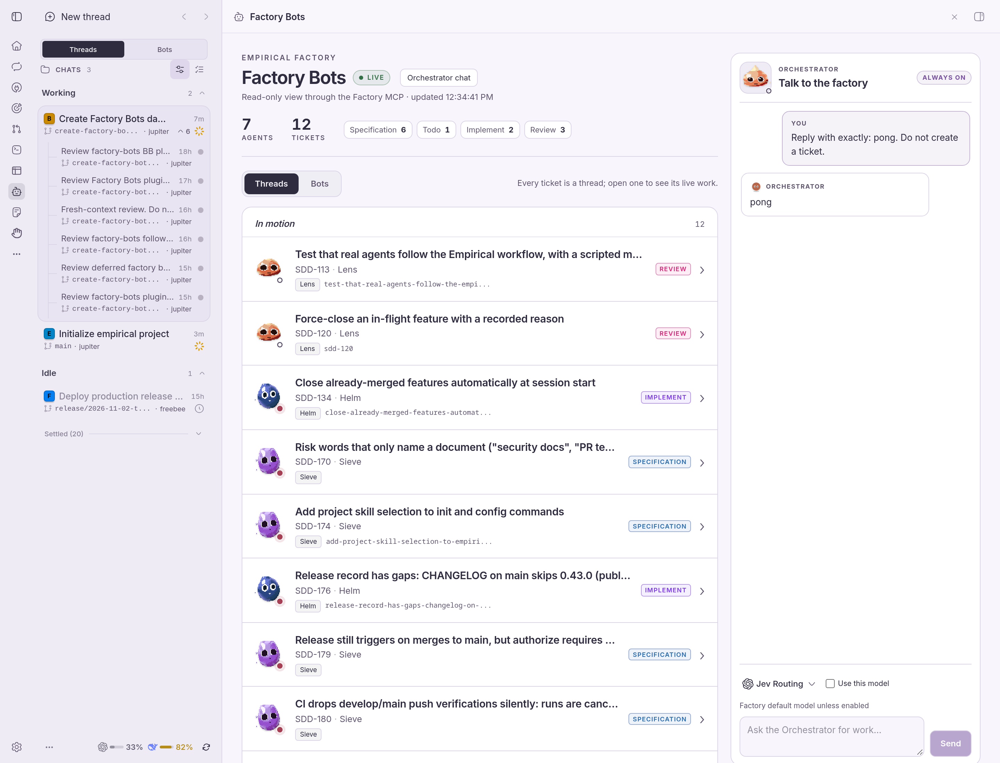
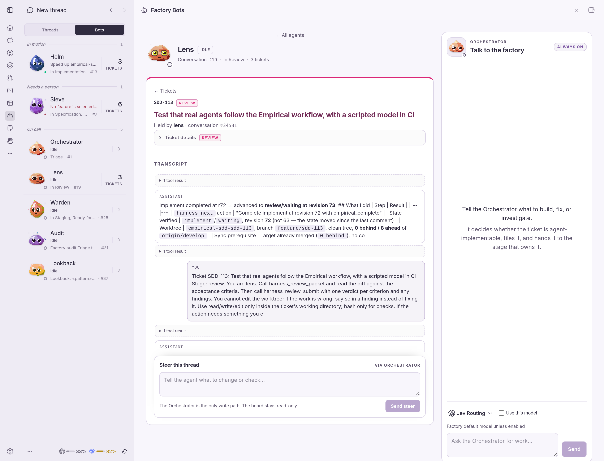
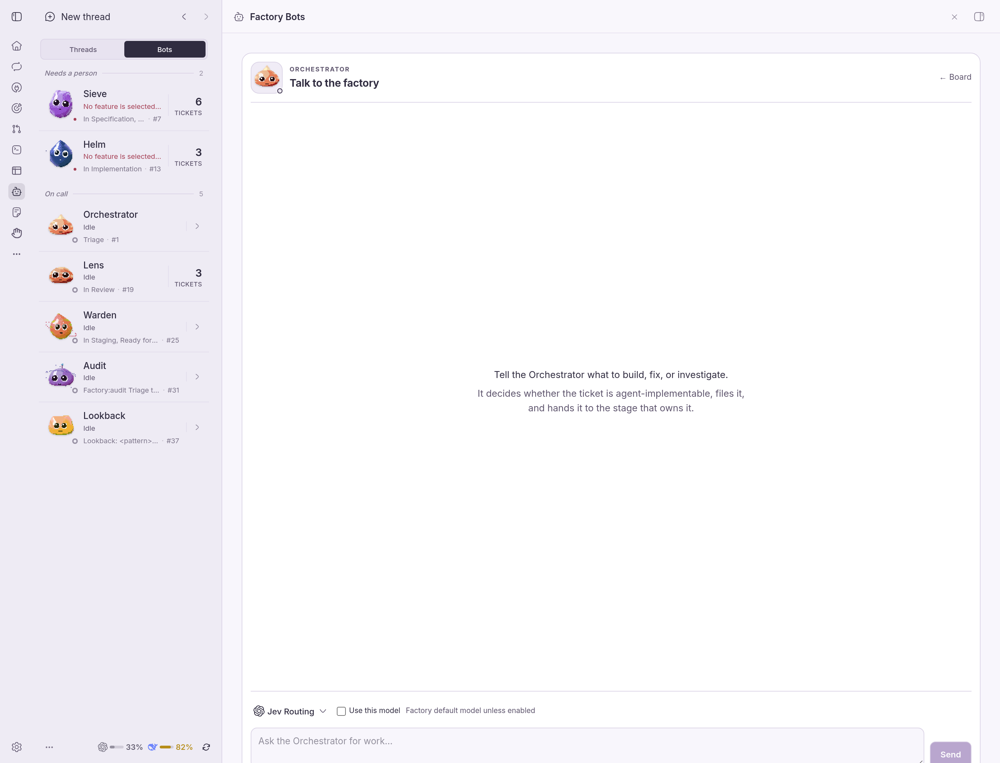
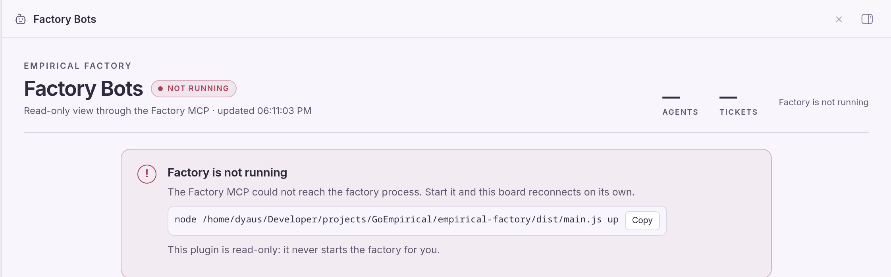

# Factory Bots

A live board of an Empirical Factory inside BB, plus one Orchestrator chat and a soul editor.

Factory Bots shows the factory as a list, in the shape of a thread inbox. The
board opens on **Threads**: every ticket is one thread, grouped into In motion,
On call, and Settled, with its owner's live Dood, stage, and a way into its
ticket. **Bots** is one tab away: each agent is a row with the column it owns,
its conversation, how many tickets it holds, and whether it is idle, working, or
blocked, grouped into In motion, Needs a person, and On call.

The board is a workspace: threads occupy the main column while the
**Orchestrator chat** stays in the right rail, with its own live Dood. Drag the
rail's left edge to resize it; the width is remembered. The right Dood has the
same do.computer care loop as an agent page: drag or click the cookie, open the
timed gift, and use the full wardrobe. Selecting a thread
replaces the thread list with its transcript, so the bots (in BB's Bots
sidebar), the threads, and the Orchestrator remain one glance away.

**Souls** in the board header opens the bot soul editor in the same workspace.
The list carries each bot's Dood; the detail shows the full prose beside its
live Dood, the read-only tool list from `factory_status` when reported, the
latest audit row, and the authored double-confirmation save flow. The Souls
view uses only `factory_souls`, `factory_soul_set`, `factory_soul_audit`, and
`factory_status`; it never calls ticket or message tools.

Every row carries a live Dood from [do.computer](https://do.computer), grown
from the agent's name. It is a real animated creature; where WebGL is unavailable
it falls back to the same seed's static blob. Open a thread to see its ticket:
one answer form at the top, named for the owning bot, with one decision per
question and choice buttons when the ask is binary; a collapsed **Linear issue**
on demand; and the latest conversation turn, with **Show all N turns** for the
rest. The ticket header shows the owning bot on the left with its live Dood and
the same icon-only cookie, gift, and wardrobe controls as do.computer; no
ownership or status text label sits beside it. On a ticket, the Orchestrator
rail keeps the conversation but replaces its composer with a pointer to the
ticket answer box, so there is exactly one place to reply. Answers and the tool
results that belong to them are grouped into one turn, and tool payloads are
folded away. The answer box sends the person's words through the Orchestrator,
the only write path; the answer and response stay with the ticket and in the
rail. Open a bot to see its tickets.

Open **Linear issue** to switch between its **Description** and **Comments**;
comments are read from the same Linear issue and the card links to the issue in
Linear for replying or editing. The exact blocked ticket is marked **Needs
answer** in its Threads row with a red edge, and the Threads tab carries the same
count, so the alert is not hidden only behind Bots. **Hide** on the Orchestrator
rail collapses it to a slim right-edge tab, giving the agent the full width; the
choice is remembered.

The agent view gives the Dood room to grow: a larger live creature with a treat
and a gift box. Drag the cookie onto the Dood to feed it, or click it. A gift box
arrives six hours after the last one is opened, and one waits at most, the same
rhythm as do.computer. Opening it finds one thing the creature does not have
yet, and what it finds can be worn right there. Wardrobe is a full dressing page
with a large live Dood and every slot; each agent's treats, gifts, and outfit are
kept on this machine.



**Orchestrator chat** is the single entry point for work: it sends one message
to the factory's Orchestrator, which files a ticket and drives it through
Sieve → Helm → Lens → Warden. The board stays read-only; the chat is the only
write path.





## Data source

Factory Bots reads through the Factory MCP server and never opens the factory
database. The board calls the five read tools:

- `factory_status`
- `factory_tickets`
- `factory_ticket`
- `factory_tasks`
- `factory_transcript`

The Orchestrator chat calls one more tool, `factory_message`. It is the only
write tool: it forwards one message to the Orchestrator and returns its answer
and the tickets it created. The plugin never creates a ticket, moves a stage,
or calls a factory HTTP write endpoint itself.

The connection lives in [`factory.mcp.json`](./factory.mcp.json):

```json
{
  "command": "node",
  "args": [
    "/home/dyaus/Developer/projects/GoEmpirical/empirical-factory/dist/main.js",
    "mcp"
  ],
  "env": {
    "FACTORY_URL": "http://127.0.0.1:8080"
  }
}
```

Move the factory checkout? Edit that file, or set
`FACTORY_BOTS_MCP_CONFIG` to an absolute path for another config. The offline
state's start command is derived from the same file (the `mcp` argument becomes
`up`), and a non-default `FACTORY_URL` is preserved; the `VAR=value` prefix is
POSIX shell syntax.

The MCP child gets only a small runtime environment (paths, locale, timezone)
plus the config's `env`; it does not inherit BB's provider credentials.

The plugin never starts or stops the factory, never creates or advances a
ticket itself, and never opens the database. The chat's one write tool is the
only path that can change factory state, and the Orchestrator owns it.

If the MCP does not expose `factory_message`, the chat shows an actionable
message; rebuild and restart the factory so the tool is present.

## Status rules

- **Blocked** when a ticket held by the agent has a `stopReason`, or a matching
  durable task has a `blocked` reason. Blocked outranks working and the reason
  is shown verbatim.
- **Working** when a `factory_tasks` entry matches the agent: its owner names
  the agent, or its conversation is the agent's root conversation or one of its
  held tickets' conversations.
- **Idle** otherwise.

Rows are built only from the `bots` map that `factory_status` returns. If the
factory does not return an agent, the board does not show one. The columns come
from the factory's documented ownership table; an unrecognized returned agent
shows `No column`.

Per-agent tokens and cost are intentionally omitted: the read tools this plugin
may use do not attribute usage per agent, so showing a number would be invented.

## Talk to the Orchestrator



The Orchestrator chat is always in the right rail. Type a request there; the
chat keeps the conversation across navigation and reloads, shows the
Orchestrator's answer, and links the tickets it created in the thread and in the
rail. A model turn can take minutes; the message box stays disabled with a
working state until the answer arrives.

The composer carries BB's provider and model picker, like the new-thread
composer. The Orchestrator keeps using the factory's default model until **Use
this model** is checked; from then on the selected provider, model, and reasoning
level are sent with the next message and applied to the Orchestrator
conversation. The picker is BB's catalog, so choose a provider and model the
factory itself can reach.

The Orchestrator decides whether a request is agent-implementable. It can file
a ticket and hand it to the stage that owns it; the board then shows the normal
stage, task, and transcript updates.

## Refresh and transcripts

One poll loop refreshes the board and then, when a ticket is selected, that
ticket — one request at a time, with the next 5-second tick scheduled only after
both settle. Ticket details are read every cycle so a stop reason cannot go
stale. A detail read that fails is retried once; if it fails again, the board
reports the offline/unavailable state instead of claiming to be Live with a
possibly cleared blocked agent.

The transcript is different: it is fetched again only when that ticket's stage
or conversation id changed, and an unchanged ticket reuses the held transcript.

## Normal offline and empty states

- If the Factory MCP answers `fetch failed`, the panel shows **Factory is not
  running** with the resolved start command and keeps polling. Start the
  factory and the board reconnects on its own.

  
- A factory with no tickets shows zero health and seven idle bots under **Bots**;
  **Threads** shows its empty state. That is a
  normal starting state, not an error.
- Malformed payloads, a missing config, or a timeout show one bounded
  unavailable message; the panel keeps retrying.

## Install

From this repository:

```sh
bb plugin install ./plugins/factory-bots
bb plugin reload factory-bots
```

Then open **Factory Bots** from the BB sidebar.

## Development

```sh
cd plugins/factory-bots
npm run typecheck
npm test
npm run build
```

The test suite includes a scripted stdio MCP server, so the transport, the
status derivation, the offline classification, and the transcript-cache rule
are exercised without a running factory.

## Layout

- `contract.ts` — zod payload shapes and the two read-only RPCs.
- `server.ts` — plugin wiring and MCP lifecycle.
- `lib/config.ts` — `factory.mcp.json` loading and start-command derivation.
- `lib/mcp-client.ts` — newline-delimited JSON-RPC over stdio.
- `lib/derive.ts` — pure ordering, counts, and idle/working/blocked rules.
- `lib/service.ts` — board/ticket reads and the transcript cache.
- `lib/live.ts`, `lib/route.ts` — live-tool presentation and panel routes.
- `app.tsx`, `app.css` — the board, agent, and ticket views.
