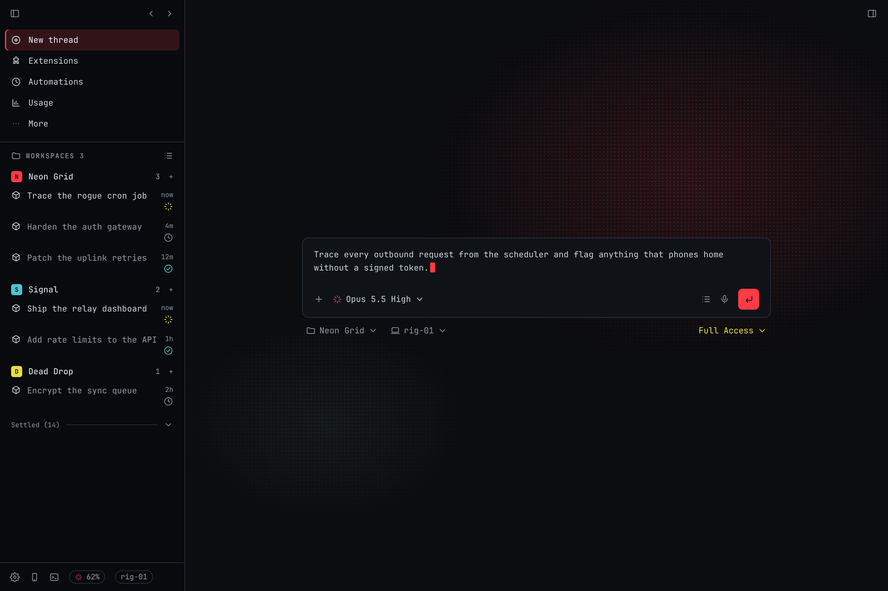
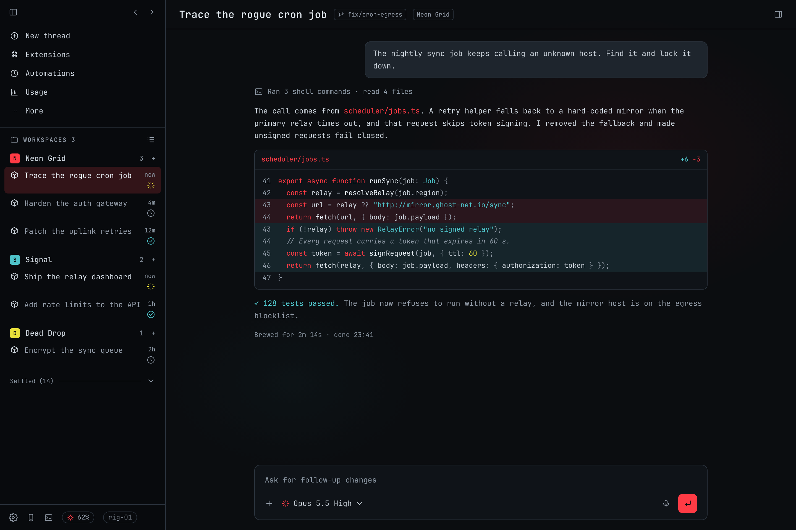

# Ghostrunner

A cyberpunk theme for BB. Near-black panels, a hot red accent, cyan for success and diffs, yellow for warnings, and monospace type throughout. Code previews and diffs use a matching syntax theme.

## Install

Install the Git release:

```sh
bb plugin install git:https://github.com/MateoCerquetella/bb-plugins.git@^0.1.0 --subdirectory plugins/ghostrunner --tag-prefix ghostrunner/
```

Then pick **Ghostrunner** in **Settings → Appearance**, or run:

```sh
bb theme set plugin:ghostrunner:ghostrunner
```

From this workspace root:

```sh
npm install
npm run check --workspace bb-plugin-ghostrunner
bb plugin install ./plugins/ghostrunner --yes
bb plugin reload ghostrunner
bb theme set plugin:ghostrunner:ghostrunner
```

To go back to the default palette, run `bb theme reset`, or disable the plugin.

## What it changes

- **Colours:** native BB colour tokens only. Ghostrunner is dark only, so Light, Dark and System all show the same palette.
- **Fonts:** JetBrains Mono for text and code, and Chakra Petch for titles. The plugin doesn't bundle fonts. If they aren't installed, BB uses your system monospace font. Both are free: [JetBrains Mono](https://www.jetbrains.com/lp/mono/) and [Chakra Petch](https://fonts.google.com/specimen/Chakra+Petch).
- **Nothing else:** the plugin includes no wallpapers, makes no network requests and stores no data.

## Preview

These are mockups with sample projects and threads. The red glow behind the composer stands in for a wallpaper.




## Wallpapers

Ghostrunner only sets colours and fonts. For a background, use [Aura](../aura), which puts your own image behind BB and can tint it to match the theme. These wallpapers suit the theme. Download one and load it into an Aura slot:

| Wallpaper | Link |
| --- | --- |
| Hooded hacker, glitch art | [wallhaven.cc/w/xlpx3z](https://wallhaven.cc/w/xlpx3z) |
| Mountain top in cyan and red | [wallhaven.cc/w/ey3jkw](https://wallhaven.cc/w/ey3jkw) |
| Voxel city at night | [wallhaven.cc/w/8oy7dk](https://wallhaven.cc/w/8oy7dk) |
| Voxel temple ruins | [wallhaven.cc/w/727md3](https://wallhaven.cc/w/727md3) |
| Night city skyline | [i.redd.it/mdvmefeejg331.jpg](https://i.redd.it/mdvmefeejg331.jpg) |
| Neon motel street in the rain | [imgur.com/dxUP3k2](https://imgur.com/dxUP3k2) |
| Circuit, Sodium, Prism, Redline, Oxide and Cobalt net wallpapers | Made by the [wrayth](https://github.com/bowenbride/wrayth) desktop shell |

Each wallpaper belongs to its artist. Check the source page for its licence before you share or reuse it.

## Development

Requires BB 0.40+; uses the workspace-pinned Plugin SDK 0.4.21.

```sh
npm run check --workspace bb-plugin-ghostrunner
```

The checks cover text and status-colour contrast (4.5:1 or better), the manifest's local theme files, and a server build.

Ghostrunner is a fan-made colour theme. It is not affiliated with or endorsed by the makers of any game.
